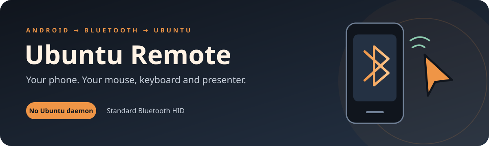
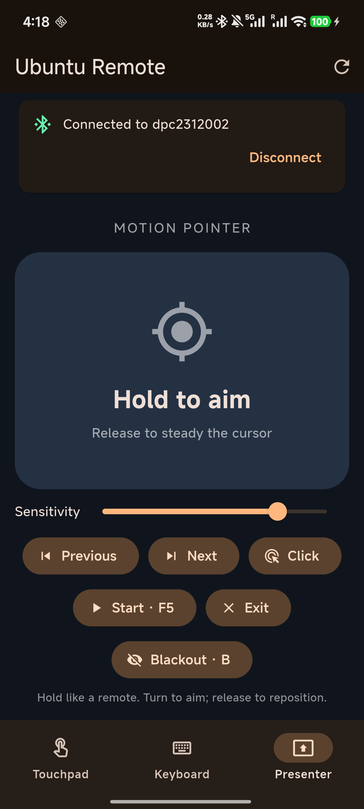

<p align="center">
  
</p>



<p align="center">
  <a href="https://github.com/Owen-Liuyuxuan/ubuntu_android_mouse/releases/latest"></a>
  
  
  
</p>

Turn an Android phone into a **Bluetooth mouse, keyboard, and motion presenter for Ubuntu**. Move the cursor with a touchpad, type from your phone, or hold a button and turn the phone to aim during a presentation.

The phone presents a standard Bluetooth HID keyboard and mouse. **No Ubuntu companion app, Wi-Fi connection, root access, or account is required.** USB ADB is used only for development and installation; normal control travels over Bluetooth.

<p align="center">
  
  <br>
  <em>Actual phone screenshot of the tested app.</em>
</p>

## Download

**[Download the APK from the latest release](https://github.com/Owen-Liuyuxuan/ubuntu_android_mouse/releases/latest)**

1. Download the `.apk` asset to your Android phone.
2. Open it and allow installation from your browser or file manager if Android asks.
3. Open **Ubuntu Remote** and follow the pairing steps below.

The first release, **v1.0.0**, is a **debug-signed prototype for local testing**, not a Play Store production build. The release includes a SHA-256 checksum file. It contains a universal APK with ARM and x86 support; actual device testing was performed on a Xiaomi 13.

## Features

- **Touchpad:** cursor movement, tap and double-tap clicks, left/right buttons, drag lock, and a dedicated scroll strip.
- **Keyboard:** send text, Enter, Backspace, Tab, Escape, arrow keys, and Ctrl+A/C/V shortcuts.
- **Motion pointer:** hold to aim, turn the phone to move the cursor, and release to reposition your hand. Gravity-relative axes support upright and flat grips; filtering reduces hand tremor, and slower turns allow finer control.
- **Presentation controls:** Previous/Next, F5, Escape, and blackout with B.
- **Connection status:** start, choose a paired host, reconnect, and disconnect from the phone.

## Requirements

- **Phone:** Android 9 / API 28 or newer, Bluetooth, and firmware exposing Android's **Bluetooth HID Device** profile. Android version alone does not guarantee firmware support.
- **Motion pointer:** a gyroscope and gravity sensor.
- **Computer:** Ubuntu with Bluetooth and standard keyboard/mouse support. Tested on Ubuntu 22.04.5 with an X11 desktop.
- **Permissions:** Nearby devices on Android 12+. Android asks separately before enabling temporary Bluetooth visibility.

## Pair with Ubuntu

1. On the phone, tap **Start remote** and allow **Nearby devices** access.
2. Wait for the app to show **Ready**, then tap **Pair new host** and allow temporary visibility.
3. On Ubuntu, open **Settings → Bluetooth**, select the phone, and confirm the matching pairing code on both devices.
4. Return to Ubuntu Remote. If needed, tap **Start remote** again, then choose your Ubuntu computer from **Select paired Ubuntu host**.
5. Wait for **Connected to …**. Keep the app open while using the remote.

> **Paired but not controlling the cursor?** If the phone was paired before the remote registered its HID service, Ubuntu can cache the phone without keyboard/mouse support. Remove the old phone pairing in Ubuntu, start the remote and wait for Ready, then pair again while the app is open. See [troubleshooting](#troubleshooting).

## Use the remote

### Touchpad

Slide a finger to move the cursor. Tap for a left click or double tap for a double click. Use **Left** and **Right** for explicit clicks, and slide on the right-hand **SCROLL** strip to scroll.

Tap **Drag** to hold the left mouse button while moving. Tap **Release** when finished.

### Keyboard

Enter text in the phone's text field and tap **Send text**. You can send up to 500 characters at once. Shortcut buttons work without entering text.

Text transmission currently supports **US-layout ASCII**. Match Ubuntu's keyboard layout to US for punctuation. Chinese/Japanese text, emoji, and other Unicode input are not supported by this implementation. Ctrl+V acts on Ubuntu's existing clipboard; it does not synchronize the phone clipboard.

### Motion presenter

1. Hold the phone like a TV remote, with its top pointing toward the screen.
2. Press and hold **Hold to aim**.
3. Turn left/right or tilt up/down to move the cursor. Rotating the phone controls movement; moving it sideways without rotating does not.
4. Release to steady the cursor or reposition your hand, then hold again to continue.
5. Adjust **Sensitivity** for your screen size and grip.

This is a **relative air mouse**, so it does not map the phone's direction to an absolute screen position. It does not draw a laser-style highlight on Ubuntu.

**Previous/Next** send Page Up/Page Down. **Start · F5**, **Exit**, and **Blackout · B** send the corresponding keyboard shortcuts; the presentation application must support them.

## Build from source

The tested toolchain is **Flutter 3.47.8 / Dart 3.13.7** with an Android SDK and a compatible JDK. The Android Gradle project compiles Java/Kotlin to JVM 17; the verified local build used Android Studio's bundled JDK 25. Android Studio is recommended for SDK management but is not required as the code editor.

```bash
git clone https://github.com/Owen-Liuyuxuan/ubuntu_android_mouse.git
cd ubuntu_android_mouse
flutter pub get
flutter doctor -v
flutter analyze
flutter test
flutter build apk --debug
```

If Android licenses are pending, review them using `flutter doctor --android-licenses`. Gradle may download required SDK/NDK components on the first build.

Install and open on a phone with USB debugging enabled:

```bash
adb devices
adb install -r build/app/outputs/flutter-apk/app-debug.apk
adb shell am start -n dev.owen.ubuntu_remote/.MainActivity
```

Run the native motion-filter tests from `android/` with a compatible `JAVA_HOME`:

```bash
cd android
./gradlew :app:testDebugUnitTest
```

The Flutter tool generates the local Android wrapper files when preparing the project. Machine-specific SDK paths, generated build files, and APKs are excluded from Git. Download the prebuilt APK from Releases.

## How it works

```text
Flutter controls
      │  platform channel
      ▼
Kotlin BluetoothHidDevice + gravity/gyroscope filter
      │  Bluetooth Classic HID reports
      ▼
Ubuntu Bluetooth stack → standard mouse and keyboard input
```

The app uses Android's public `BluetoothHidDevice` API and a combined HID descriptor for keyboard and relative mouse reports. It releases held keys/buttons and stops motion sensing when the activity pauses. Android can unregister the HID application when it is no longer foreground, so switching apps or locking the phone may require reconnecting.

Key source files:

- [`lib/main.dart`](lib/main.dart): connection UI, touchpad, keyboard, and presenter.
- [`MainActivity.kt`](android/app/src/main/kotlin/dev/owen/ubuntu_remote/MainActivity.kt): Bluetooth permissions, registration, reports, and lifecycle handling.
- [`MotionPointer.kt`](android/app/src/main/kotlin/dev/owen/ubuntu_remote/MotionPointer.kt): gravity-relative motion mapping, tremor filtering, and slow-turn precision.
- [`test/widget_test.dart`](test/widget_test.dart): disconnected controls and connected input actions.
- [`MotionPointerTest.kt`](android/app/src/test/kotlin/dev/owen/ubuntu_remote/MotionPointerTest.kt): grip consistency, pitch direction, drift suppression, and clutch reset.

## Validation

The initial app was tested on a **Xiaomi 13 running Android API 36** connected to **Ubuntu 22.04.5 over Bluetooth**.

- Ubuntu enumerated separate Bluetooth mouse and keyboard input devices.
- Host-side input capture verified cursor motion, balanced left-click press/release events, and the exact `hello` key sequence.
- The user confirmed that all three modes worked, and that the revised gravity-relative presenter felt more natural.
- **2 Flutter widget tests and 4 Kotlin motion tests passed.** Static analysis and the debug APK build passed.
- The APK uploaded for v1.0.0 matches the installed, tested APK by SHA-256.

These results cover the tested phone and Ubuntu setup; other firmware, desktop environments, and keyboard layouts have not been validated. See [`VALIDATION.json`](VALIDATION.json) for the recorded checks.

## Troubleshooting

**Paired, but the app cannot connect**

Start the remote before pairing so Ubuntu discovers the HID service. If necessary, remove the old pairing and pair again. On Ubuntu, check:

```bash
bluetoothctl devices
bluetoothctl info <phone-bluetooth-address>
```

The phone should advertise **Human Interface Device**, UUID `00001124-0000-1000-8000-00805f9b34fb`. Pairing alone does not establish the HID connection; select Ubuntu in the app and wait for Connected.

**Disconnected after changing apps or locking the phone**

Return to Ubuntu Remote, tap Start if required, and select the host again. The current implementation is designed for foreground use.

**Motion feels too fast or shaky**

Lower Sensitivity, use deliberate rotations, and release/regrip to recenter your hand. Fine turns use lower gain. This is an air mouse, not an optically tracked absolute pointer.

**Punctuation types incorrectly**

Use a US keyboard layout on Ubuntu. Unicode/IME text transmission is not implemented.

**ADB can install the app but cannot tap the screen on Xiaomi**

Some Xiaomi firmware requires the separate **USB debugging (Security settings)** developer option for injected ADB touches. Manual testing works without enabling it; this restriction does not affect Bluetooth input.

## References

- [Android Bluetooth HID Device API](https://developer.android.com/reference/android/bluetooth/BluetoothHidDevice)
- [Android Bluetooth permissions](https://developer.android.com/develop/connectivity/bluetooth/bt-permissions)
- [Flutter platform channels](https://docs.flutter.dev/platform-integration/platform-channels)
